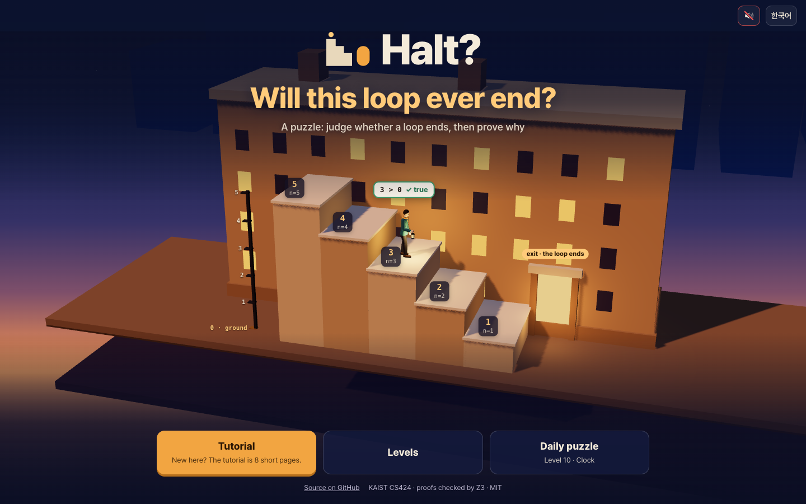
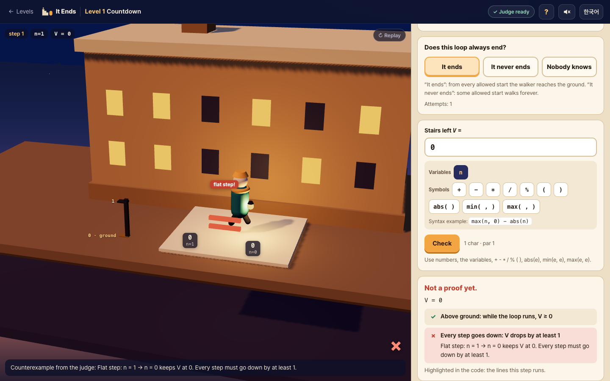
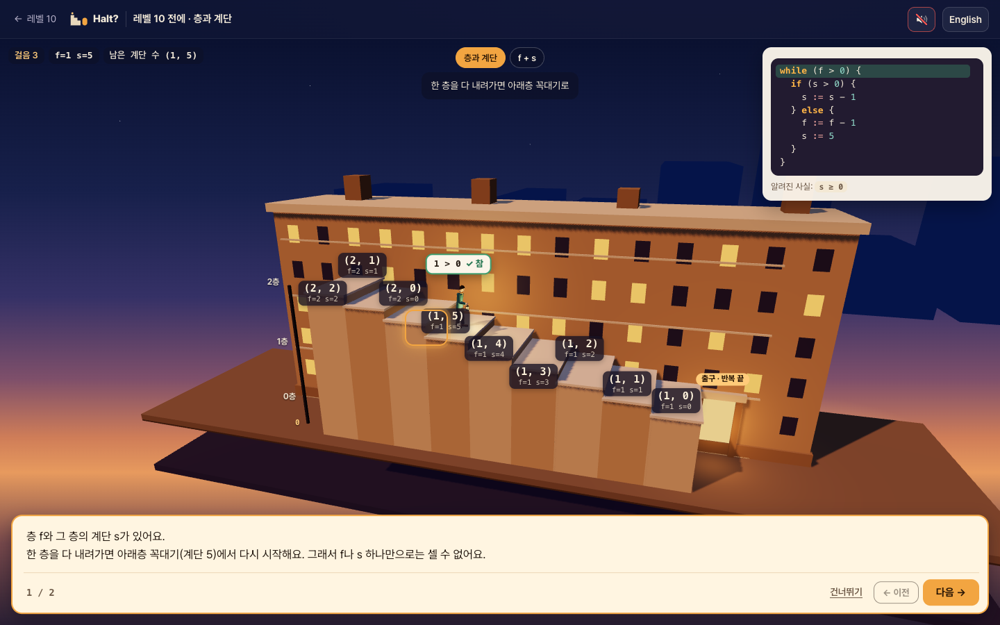
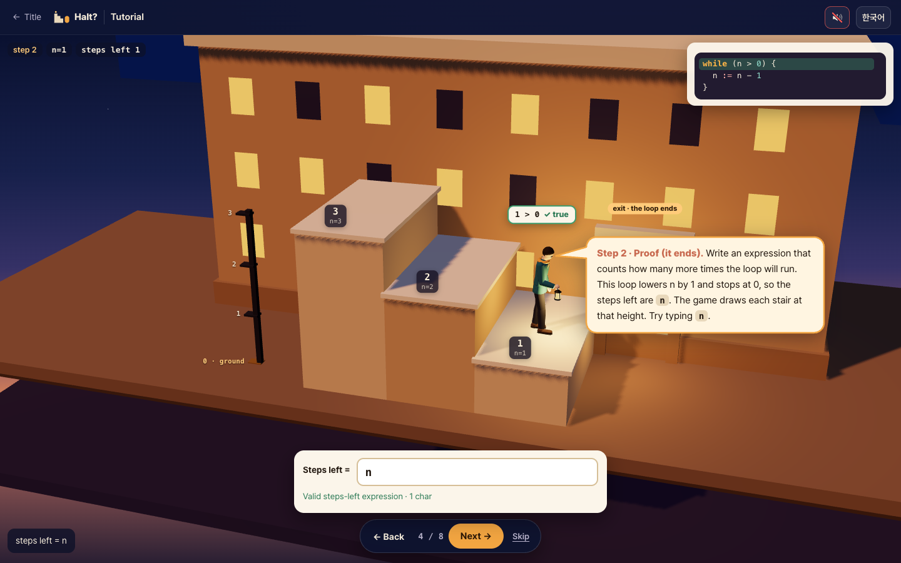
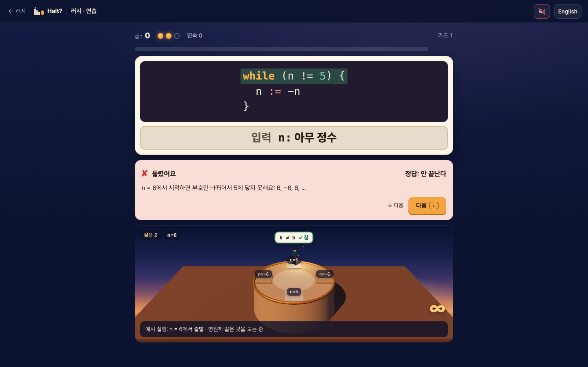
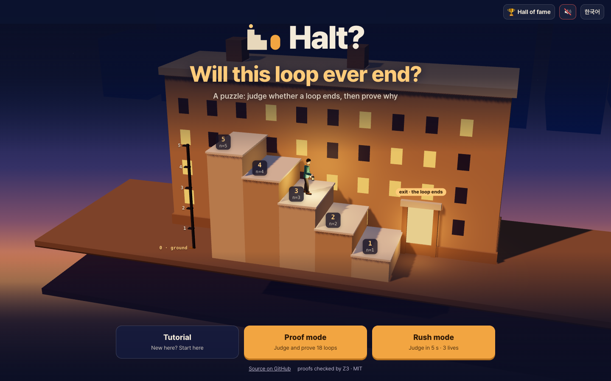
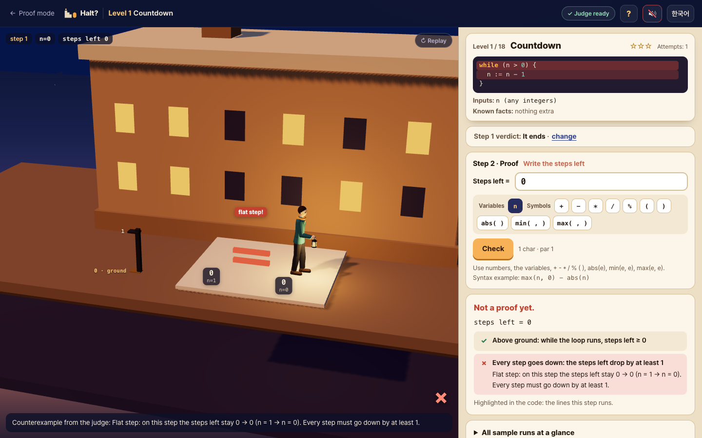
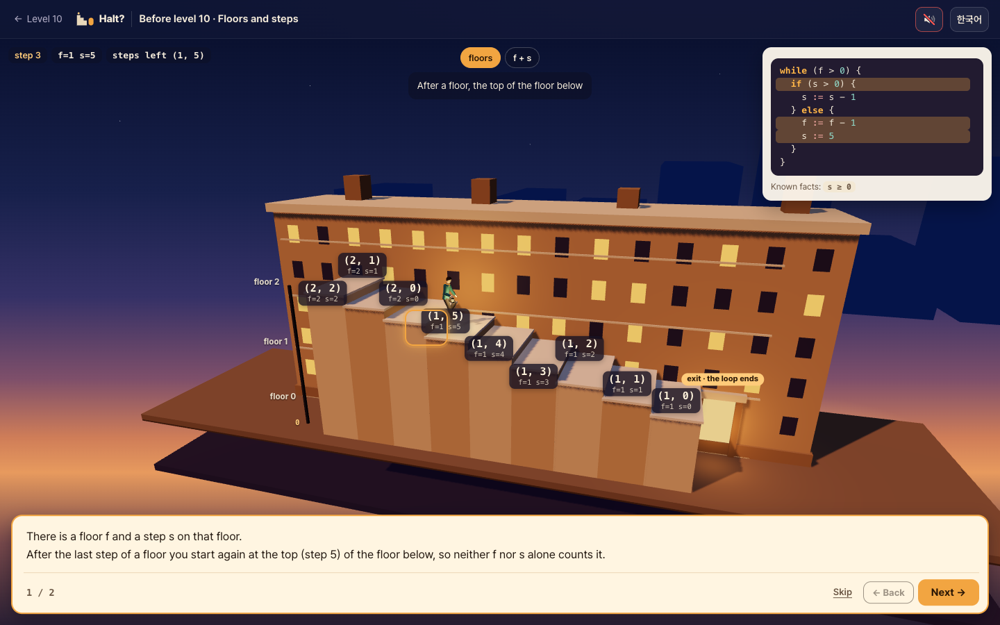
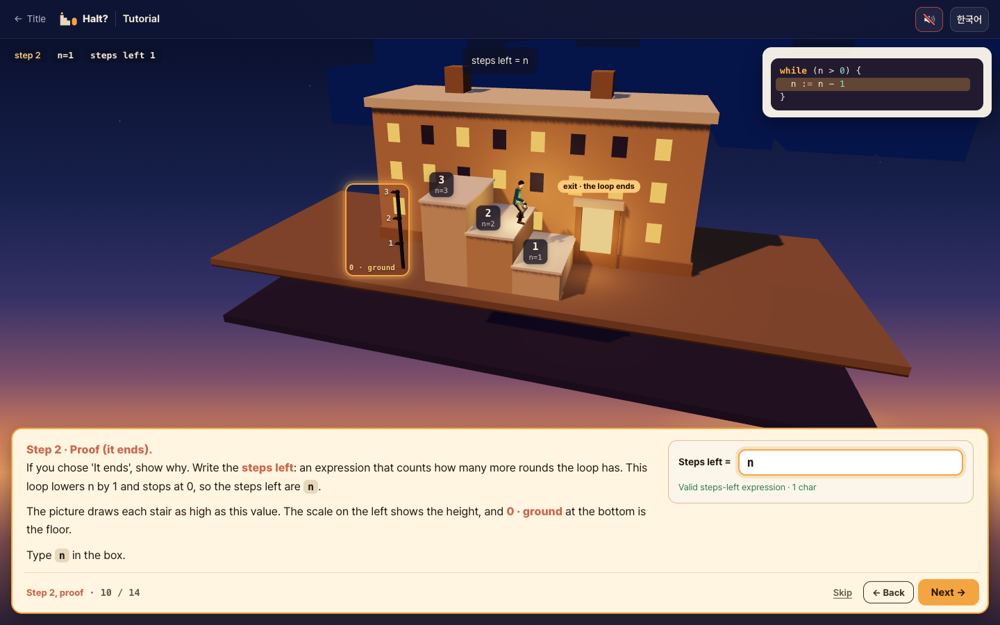
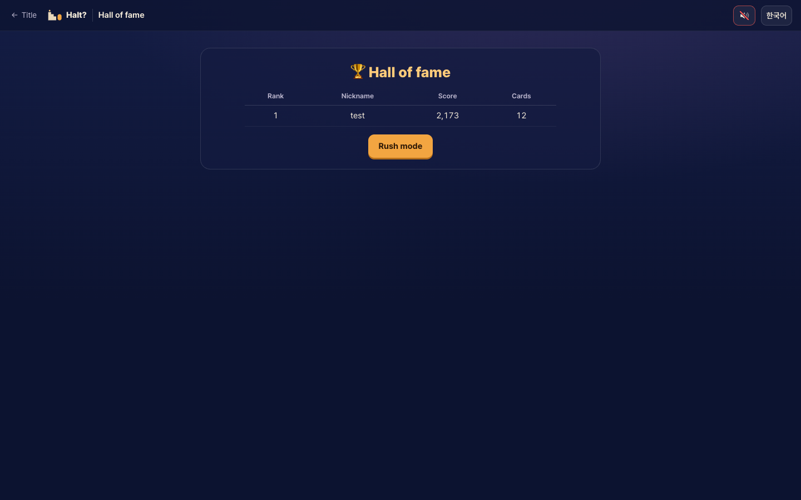

# Halt?

반복문이 끝나는지 판정하고 증명하는 브라우저 퍼즐 게임 · A browser puzzle game: judge whether a loop ends, then prove it

플레이 / Play: <https://halt-seven-delta.vercel.app/>



[한국어](#한국어) · [English](#english)

---

## 한국어

### 무엇인가요

<strong>Halt?</strong>는 반복문이 끝나는지 판정하고 왜 그런지 증명하는 브라우저 퍼즐 게임입니다. 다른 사람과 점수를 겨루는 경쟁 게임이기도 합니다. 러시 모드에서는 카드마다 5초 안에 판정하고, 판이 끝나면 점수가 닉네임과 함께 온라인 **명예의 전당**에 올라갑니다.

프로그램이 맞다는 증명은 두 조각으로 나뉩니다. "끝나면 결과가 맞다"(부분 정확성)와 "반드시 끝난다"(종료)입니다. Halt?는 뒤 조각인 **종료**를 연습하는 게임입니다. 종료를 증명할 때도 불변식이 필요한 경우가 있어서, 게임을 하다 보면 불변식도 함께 찾게 됩니다.

증명은 브라우저 안에서 돌아가는 SMT 풀이기 **Z3**와 실행기가 검사합니다.

### 세 가지 모드

처음 화면에는 모드가 셋 있습니다.

- **튜토리얼**: 화면의 각 부분이 무엇인지 하나씩 짚어 주는 게임 시뮬레이션입니다. 처음이라면 여기부터 시작하세요.
- **증명 모드**: 반복문의 종료를 판정하고 증명합니다. 18 단계로 구성되어 있습니다.
- **러시 모드**: 프로그램이 종료하는지를 빠르게 판단합니다. 카드마다 5초, 목숨 3개입니다. 다른 사람과 경쟁하는 모드로, 닉네임과 점수가 명예의 전당에 표시됩니다. 오른쪽 위의 🏆 버튼을 누르면 명예의 전당이 열립니다.


### 증명 모드

#### 무대

반복문은 건물 앞 계단을 내려가는 사람으로 그려집니다. 반복을 한 번 돌 때마다 한 칸 내려가고 반복이 끝나면 출구로 나갑니다.

걸음마다 반복 조건을 먼저 확인합니다. 그래서 처음부터 조건이 거짓이면 한 걸음도 걷지 않고 나갑니다(레벨 2에서 `n = −3`).

무대의 각 부분은 코드와 짝을 이룹니다.

- 사람 머리 위의 `3 > 0 ?`는 반복 조건 검사입니다.
- 계단 칸 앞의 `n=3`은 그 칸의 변수 값입니다.
- 왼쪽 위의 「걸음 1」은 반복을 몇 번 돌았는지 보여 줍니다.
- 사람이 걷는 동안 코드에서도 지금 실행하는 줄이 밝아집니다.

#### 1단계 · 판정

레벨마다 먼저 셋 중 하나를 고릅니다.

- **끝난다**: 허용된 어떤 시작값에서도 언젠가 출구에 닿습니다.
- **안 끝난다**: 영원히 걷게 되는 시작값이 하나라도 있습니다.
- **아무도 모른다**: 마지막 레벨(콜라츠)에서만 정답입니다.

**끝난다**나 **안 끝난다**를 고르면 2단계 증명 칸이 열리고, **아무도 모른다**는 고르는 즉시 판정합니다. 고른 판정은 「바꾸기」로 바꿀 수 있습니다.

#### 2단계 · 증명

**끝난다**를 골랐다면 **남은 계단 수**를 씁니다. 반복이 앞으로 몇 번 남았는지 세는 식, 곧 순위 함수(ranking function)입니다. 정확한 횟수가 아니어도 됩니다.

게임은 예시 실행의 상태마다 그 식의 값만큼 높은 계단을 그립니다. 난간이 없으면 판정기는 두 가지만 검사합니다.

1. 한 번 돌 때마다 줄어드는가? 줄지 않으면 계단이 평평해져 사람이 휘청하거나, 오르막이 되어 위로 올라갑니다.
2. 걷는 동안 0 밑으로 내려가지 않는가? 내려가면 사람이 바닥을 뚫고 지하로 떨어집니다.

Z3는 예시 실행뿐 아니라 반복 조건이 참인 모든 상태를 검사합니다. 틀리면 Z3가 찾은 반례가 무대에서 그대로 재생됩니다.

**안 끝난다**를 골랐다면 영원히 걷는 시작값을 줍니다. 걸어 보다가 같은 상태로 돌아오면 그것으로 증명이 끝납니다. 10,000걸음을 걸어도 같은 상태가 다시 나오지 않으면, 그 실행이 빠져나오지 못하는 **바닥 없는 구역** Z(recurrent set)를 더 씁니다. Z는 Z3가 검사합니다.

| 판정 (1단계) | 내는 증명 (2단계) | 검사 |
|---|---|---|
| **끝난다** | 남은 계단 수. 필요하면 난간 R(보조 불변식)도 | Z3 |
| **안 끝난다** | 영원히 걷는 시작값. 같은 상태가 다시 나오지 않으면 바닥 없는 구역 Z도 | 실행(상태 반복) 또는 Z3 |
| **아무도 모른다** | 없음 | 마지막 레벨(콜라츠)에서만 정답 |

#### 난간: 불변식이 필요한 순간

판정기는 반복 조건이 참인 **모든** 상태를 의심합니다. 예를 들어 `k := 10; while (k != 0) { k := k - 1 }`의 남은 계단 수는 `k`이지만 판정기는 "k가 −5라면?" 하고 묻습니다.

실제 실행은 그런 상태에 가지 않습니다. 이것을 판정기에 알려 주려면 시작할 때 참이고, 참인 상태에서 한 걸음 가도 여전히 참인 조건(귀납적 불변식) `k >= 0`을 **난간** R로 줍니다. 레벨 7부터 난간을 쓸 수 있고, 몇몇 레벨은 난간이 있어야 증명됩니다.

#### 층과 계단: 사전식 순서

시계처럼 도는 반복문이 있습니다. 레벨 10에서는 분(y)이 0이 되면 다음 걸음에서 시(x)가 하나 줄고, 분은 다시 59가 됩니다. 이런 반복문은 변수 하나만 보고는 셀 수 없습니다.

레벨 10부터는 남은 계단 수를 `(층, 계단)` 같은 튜플로 쓸 수 있습니다. 층이 줄거나 같은 층에서 계단이 줄면 내려간 것입니다.

#### 입력할 수 있는 것

- 레벨의 변수, 정수, `+ - * / %`, 괄호, `abs(e)`, `min(e, e)`, `max(e, e)`. 입력칸 아래 버튼을 눌러 넣을 수도 있습니다.
- 남은 계단 수 칸에는 레벨 10부터 `(a, b)`, `(a, b, c)` 같은 튜플도 씁니다.
- 난간이나 바닥 없는 구역처럼 조건을 쓰는 칸에는 `== != < <= > >= && || !`도 씁니다.
- `/`와 `%`는 나머지가 0 이상이 되도록 계산합니다(`-7 / 2 = -4`, `-7 % 2 = 1`).

#### 반례, 별, 레벨 묶음

- 남은 계단 수나 바닥 없는 구역이 틀리면 언제나 Z3 모델에서 뽑은 **구체적인 반례**가 따라옵니다. 어느 걸음이 왜 틀렸는지 상태 값과 함께 알려 주고 무대에서 그 걸음을 보여 줍니다.
- 끝나지 않는 실행은 지하로 끝없이 내려가거나(바닥 없는 구역) 둥근 탑 위를 계속 돕니다(순환).
- 레벨은 기초 · 한 걸음 더 · 층과 계단 · 응용 · 마지막의 다섯 묶음입니다. 처음부터 모두 열려 있습니다.
- 별은 풀면 ★, 3번 안에 풀면 ★★입니다. 끝나는 레벨은 거기에 더해 답이 기준 길이 이하이면 ★★★입니다. 답 길이에는 난간도 들어가고 빈칸은 세지 않습니다. 안 끝나는 레벨과 마지막 레벨은 첫 시도에 풀면 ★★★입니다.
- 식 오류, 허용되지 않는 시작값, 판정기 시간 초과(5초)는 시도 횟수에 넣지 않습니다.

| 레벨 1: 남은 계단 수 0의 반례 | 레벨 10 앞 소개: 층과 계단 |
|---|---|
|  |  |

### 튜토리얼과 안내

**튜토리얼**은 14쪽, 다섯 부분(시작 · 무대 읽기 · 1단계 판정 · 2단계 증명 · 시작하기)입니다.

- 코드를 먼저 읽게 한 뒤, 무대의 각 부분(왼쪽 위의 걸음과 변수 값, 사람과 계단 칸, 조건 검사, 출구, 높이 눈금)을 주황 테두리로 하나씩 짚습니다.
- 「한 단계 ▶」 버튼을 누르면 조건 검사와 한 칸 내려가기가 하나씩 진행되고 코드의 밝은 줄과 걸음 수도 함께 바뀝니다.
- 남은 계단 수를 직접 입력해 보는 칸이 있어서 식에 따라 계단 모양이 어떻게 바뀌는지 볼 수 있습니다.
- 설명은 무대 아래 넓은 글 상자에 나옵니다. 쪽은 ← / → 키로도 넘길 수 있습니다.

첫 예제는 일부러 레벨 1과 같은 반복문으로 했습니다. 나머지 예제는 레벨과 똑같은 반복문이 아닙니다. 다만 레벨 10 앞의 층과 계단 소개는 레벨 10과 짜임이 같은 반복문으로 튜플 쓰는 법을 미리 보여 줍니다.

**레벨 화면 안내**: 증명 모드에서 처음으로 레벨을 열면 무대, 레벨 이름과 별, 코드, 입력, 알려진 사실, 판정 버튼, 판정기 표시와 「?」 버튼을 차례로 짚어 줍니다. 끝난다 증명 칸이 처음 열릴 때, 남은 계단 수가 처음 틀렸을 때, 안 끝난다 증명 칸이 처음 열릴 때도 짧은 안내가 나옵니다.

**개념 소개**: 새 개념이 처음 나오는 레벨 5(바닥 없는 구역), 7(난간), 10(층과 계단) 앞에는 두 쪽짜리 소개가 있습니다. 튜토리얼과 안내, 소개는 모두 레벨 화면의 「?」에서 다시 볼 수 있습니다.



### 러시 모드와 명예의 전당

짧은 반복문 카드가 한 장씩 나옵니다. 카드마다 **5초** 안에 **끝난다**(← 또는 1)나 **안 끝난다**(→ 또는 2)를 고릅니다. 증명은 쓰지 않습니다. 판정의 뜻은 증명 모드와 같습니다.

**판의 규칙**

- 목숨은 3개입니다. 틀리거나 시간이 다 되면 하나를 잃습니다.
- 목숨이 남아 있는 한 카드는 끝없이 나옵니다.
- 답하면 정답과 이유 한 줄이 나옵니다. 무대의 사람이 그 카드의 반복문을 예시 시작값 하나로 걸어 보입니다. 다음 카드는 ↓ 키나 「다음」 버튼으로 넘깁니다. 저절로 넘어가지 않으니 이유를 천천히 읽어도 됩니다.

**점수**

- 맞힌 카드의 점수는 `(100 + 20 × 남은 초) × 연속 배수`를 반올림한 값입니다.
- 남은 초는 0.1초 단위로 내림하고, 0.2초보다 빨리 답해도 0.2초로 칩니다. 그래서 연속 배수를 곱하기 전에는 카드 한 장에 100점에서 196점입니다.
- 연속 배수는 두 장 연속으로 맞히면 ×1.25, 세 장이면 ×1.5, 네 장이면 ×1.75, 다섯 장부터는 ×2입니다. 틀리거나 시간이 다 되면 ×1로 돌아갑니다.

**명예의 전당**

- 처음 들어갈 때 닉네임을 정하면, 판이 끝날 때 점수가 온라인 명예의 전당에 올라갑니다.
- 명예의 전당은 닉네임마다 최고 점수를 보여 줍니다. 기록은 지워지지 않습니다. 상위 10명까지 나옵니다.
- 닉네임은 2자에서 12자이고 한글, 영문, 숫자, 빈칸, `_`, `-`를 쓸 수 있습니다. 욕설은 막습니다.
- 닉네임은 그 닉네임을 처음 쓴 기기에서만 쓸 수 있습니다.
- 순위에 들어가지 않는 **연습**도 있습니다. 연습은 서버와 전혀 통신하지 않습니다.

**카드 500장**

- 하 150장, 중 175장, 상 175장입니다. 몇 번째 카드에 어느 난이도가 나올지는 정해져 있습니다. 앞부분은 하가 많고 갈수록 중·상이 늘어납니다.
- 같은 난이도 안에서는 그 기기에서 아직 안 본 카드 가운데 하나를 무작위로 고릅니다. 그래서 여러 번 도전해도 같은 카드를 다시 만나는 일이 적습니다.
- 카드마다 **입력** 조건이 코드만큼 크게 적혀 있습니다. 코드가 거의 같은데 판정이 반대인 카드 짝이 230쌍입니다. 그중 49쌍은 코드가 똑같고 입력 조건만 다릅니다. 코드만 보고 고르면 틀리기 쉽습니다.
- 32장은 직접 만들었고 468장은 `scripts/gen-rush-cards.ts`가 만들었습니다(`npm run gen-cards`). 모든 카드의 판정은 `npm test`에서 확인합니다. 끝나는 카드는 기준 남은 계단 수(필요하면 난간)가 실제 판정기(Z3)를 통과합니다. 안 끝나는 카드는 상태가 되풀이되는 시작값이나 Z3가 확인한 바닥 없는 구역이 있습니다.

| 러시 모드 | 명예의 전당 |
|---|---|
|  |  |

### 개념 ↔ 게임

| 개념 | 게임 |
|---|---|
| 순위 함수 | 남은 계단 수 (상태마다 그 높이의 계단) |
| 반복하는 동안 남은 계단 수 ≥ 0 | 땅 위에 있기 (땅 밑 = 지하로 떨어짐) |
| 매 반복 남은 계단 수가 1 이상 감소 | 매 걸음 내려가기 (평평하거나 올라가는 걸음 = 실패) |
| 사전식 튜플 (a, b) | a층의 b번째 계단. 한 층 내려가면 계단 번호는 다시 꼭대기부터 |
| 반복 조건이 처음부터 거짓 | 걷기 전에 출구로 나감 (0걸음) |
| 보조 불변식 (supporting invariant) | 난간 R |
| recurrent set | 바닥 없는 구역 Z |

**완전 정확성(total correctness)은 부분 정확성(루프 불변식)과 종료(순위 함수)를 합친 것입니다.** Halt?는 종료 쪽을 다루지만, 종료를 증명할 때도 보조 불변식인 난간이 필요할 때가 있습니다.

난간은 판정기가 따지는 상태를 난간이 참인 상태로 좁혀 줍니다. 실제 실행이 닿는 상태는 모두 난간 안에 있으므로, 실제로는 오지 않는 상태를 걸러 낼 수 있습니다.

안 끝난다는 증명에 쓰는 바닥 없는 구역 Z는 고른 시작값에서 참이고, Z 안에서는 반복 조건이 늘 참이며, 한 걸음 가도 다시 Z 안에 있는 조건입니다. 한 걸음 뒤에도 유지된다는 점에서 불변식과 닮았습니다.

### 검사 (정확히 이것만)

`Start` = 시작 조건과 초기화, `Facts` = 반복 조건을 검사할 때마다 늘 참이라고 레벨이 알려 주는 사실(화면의 '알려진 사실'), `G` = 반복 조건,
`Step(s, s')` = 몸통의 각 경로에 대해 `경로 조건 ∧ s' = 대입(s)`의 논리합입니다. 모든 변수는 수학의 정수입니다.

- **끝난다**: (R이 있으면) `Start ⇒ R`, `Facts ∧ R ∧ G ∧ Step ⇒ R'` /
  `Facts ∧ R ∧ G ⇒ 남은 계단 수 ≥ 0` (튜플은 모든 성분) /
  `Facts ∧ R ∧ G ∧ Step ⇒ 남은 계단 수' ≤ 남은 계단 수 − 1` (튜플은 사전식으로 엄격히 감소, `'`는 한 걸음 뒤의 값)
- **안 끝난다**: 시작값이 `Start`를 만족하는지 보고 10,000걸음까지 실행합니다. 그 사이에 반복이 끝나면 증명이 아닙니다. 상태가 되풀이되면 순환으로 증명됩니다. 끝나는 레벨에서는 끝나는 모습을 보여 주려고 1,000,000걸음까지 더 걸어 봅니다.
  둘 다 아니면 Z를 받아 `Z(s0)`, `Z ⇒ G`, `Facts ∧ Z ∧ G ∧ Step ⇒ Z'`를 Z3로 검사합니다.
- 질의마다 Z3 시간 제한은 5초입니다. 넘으면 "판정기가 결정하지 못했어요"라고 알리고 시도 횟수에 넣지 않습니다.

`/`와 `%`는 판정기와 실행기 모두 SMT-LIB/Z3 의미(유클리드 나눗셈, 나머지 ≥ 0)를 씁니다. 그래서 화면의 실행과 증명이 어긋나지 않습니다. SMT-LIB가 정하지 않은 0으로 나누기는 양쪽 모두 `x / 0 = 0`, `x % 0 = x`로 정했습니다.

### 실행

```sh
npm i
npm run dev          # http://localhost:5173 (개발 서버가 COOP/COEP 헤더를 보냄)
npm test             # node --test: 파서, 레벨 18개, 튜토리얼 예제, 러시 카드 500장(Z3·실행), 점수 서버 검사, / % 의미, 화면 배치 (Node 24 권장)
npm run build        # dist/ (base './', 하위 경로에서도 동작)
npm run gen-cards    # 러시 카드 다시 만들기 (src/core/rushBank.ts)
npm run serve:pages  # dist/를 http://localhost:4174/halt/ 에서 특별한 헤더 없이 제공 (GitHub Pages 흉내)
```

주소 끝에 `?mute`를 붙이면 소리가 나지 않습니다. `?flat`을 붙이면 3차원 시뮬레이션 대신 평면 그림으로 봅니다(WebGL이 없을 때 자동으로 쓰는 그림).

게임은 [Vercel](https://vercel.com)에서 서비스합니다. `main`에 푸시하면 Vercel이 빌드하고 배포합니다. `vercel.json`이 교차 출처 격리 헤더(COOP `same-origin`, COEP `require-corp`)를 붙입니다. `.github/workflows/pages.yml`은 테스트와 빌드를 돌린 뒤, 옛 주소 `jkkms.github.io/halt/`에 새 주소로 넘기는 페이지만 올립니다.

### 크레딧

- [Z3](https://github.com/Z3Prover/z3) (Microsoft Research, MIT)와 npm 패키지 `z3-solver`
- [coi-serviceworker](https://github.com/gzuidhof/coi-serviceworker) (Guido Zuidhof, MIT)
- [three.js](https://github.com/mrdoob/three.js) (MIT), [Pretendard](https://github.com/orioncactus/pretendard) (길형진, SIL OFL 1.1)
- [Cloudflare Workers](https://workers.cloudflare.com)와 D1 (명예의 전당 서버)
- KAIST CS424 프로그램 논증
- 게임 방식과 디자인은 작성자가 계획하고 설계했습니다. 구현에는 클로드(Claude)의 도움을 받았습니다.

### 라이선스

MIT. [LICENSE](LICENSE)를 보세요.

---

## English



### What it is

<strong>Halt?</strong> is a browser puzzle game where you judge whether a loop ends, then prove why. It is also a competitive game: in rush mode you judge each card within 5 seconds, and when a run ends, your score goes to an online **hall of fame** with your nickname.

A proof that a program is correct has two pieces: "if it ends, the result is right" (partial correctness) and "it does end" (termination). Halt? is for practising the second piece, **termination**. Proving termination sometimes needs invariants too, so you end up finding invariants along the way.

Proofs are checked by **Z3**, an SMT solver running in your browser, and by the game's simulator.

### Three modes

The title screen has three modes.

- **Tutorial**: a game simulation that shows what each part of the screen is, one at a time. Start here if you are new.
- **Proof mode**: judge whether loops end and prove it, in 18 levels.
- **Rush mode**: judge quickly whether programs end. 5 seconds a card, 3 lives. This is the competitive mode: nicknames and scores show in the hall of fame. The 🏆 button at the top right opens the hall of fame.

### Proof mode

#### The stage

A loop is drawn as a person walking down the stairs in front of a building. Each time the loop runs once, they go down one stair; when the loop ends, they leave by the exit.

The loop condition is checked before every step, so if it is false from the start, they leave without taking a step (level 2 with `n = −3`).

Every part of the stage matches the code.

- The `3 > 0 ?` above the person's head is the loop check.
- The `n=3` on the front of a stair is the variable's value on that stair.
- "step 1" at the top left counts the rounds so far.
- While the person walks, the line being run lights up in the code.

#### Step 1 · Verdict

In each level you first choose one of three:

- **It ends**: from every allowed start, the walker reaches the exit sooner or later.
- **It never ends**: some allowed start makes them walk forever.
- **Nobody knows**: the right answer only in the last level (Collatz).

Choosing **It ends** or **It never ends** opens the proof box for step 2; **Nobody knows** is judged at once. "change" lets you pick again.

#### Step 2 · Proof

If you chose **It ends**, write the **steps left**: an expression that counts how many more times the loop will run, i.e. a ranking function. It need not be the exact count.

The game draws every state of the sample runs as a stair as high as your expression's value there. Without a railing, the judge checks only two things:

1. Does it go down every time the loop runs? If not, a flat stair makes the walker stumble, or the stairs go up and the walker climbs.
2. Does it stay at 0 or above while walking? If not, the walker falls through the floor into the basement.

Z3 checks every state where the loop condition holds, not only the sample runs. If you are wrong, the counterexample Z3 found is played on the stage.

If you chose **It never ends**, give a start that walks forever. If the walk comes back to a state it has been in, that is the proof. If no state repeats within 10,000 steps, you also write a **bottomless zone** Z (a recurrent set) that the run cannot leave. Z3 checks Z.

| Verdict (step 1) | Proof you give (step 2) | Checked by |
|---|---|---|
| **It ends** | the steps left, and a railing R (supporting invariant) if needed | Z3 |
| **It never ends** | a start that walks forever; if no state repeats, also a bottomless zone Z | simulation (repeated state) or Z3 |
| **Nobody knows** | nothing | right only in the last level (Collatz) |

#### Railings: when you need an invariant

The judge suspects **every** state where the loop condition holds. For `k := 10; while (k != 0) { k := k - 1 }` the steps left are `k`, but the judge asks: what if k were −5?

A real run never gets there. To tell the judge so, give a condition that holds at the start and still holds after a step from any state where it holds (an inductive invariant), `k >= 0`, as a **railing** R. Railings open from level 7, and some levels can only be proved with one.

#### Floors and steps: lexicographic order

Some loops run like a clock. In level 10, when the minutes (y) reach 0, the next step takes one off the hours (x) and sets the minutes back to 59. No single variable counts such a loop.

From level 10 you may write the steps left as a tuple such as `(floor, step)`. Going down means a lower floor, or the same floor and a lower step.

#### What you can type

- The level's variables, whole numbers, `+ - * / %`, parentheses, `abs(e)`, `min(e, e)`, `max(e, e)`. The buttons under the answer box type them for you.
- From level 10, the steps-left box also takes tuples such as `(a, b)` or `(a, b, c)`.
- Boxes that take a condition, such as railings and bottomless zones, may also use `== != < <= > >= && || !`.
- `/` and `%` keep the remainder at 0 or above (`-7 / 2 = -4`, `-7 % 2 = 1`).

#### Counterexamples, stars and level groups

- A wrong steps left or bottomless zone always comes with a **concrete counterexample** taken from Z3's model. The game says which step failed and why, with the state's values, and shows that step on the stage.
- A run that never ends keeps going down into the basement (a bottomless zone) or circles a round tower (a cycle).
- The levels come in five groups (Basics · One step further · Floors and steps · Applied · The last one), all open from the start.
- Stars: ★ for solving, ★★ for solving within 3 tries. In a level that ends, ★★★ also needs an answer no longer than par; the railing counts toward the length, spaces do not. In a never-ending level or the last level, ★★★ means solving on the first try.
- Parse errors, disallowed starts and judge timeouts (5 s) do not count as tries.

| Level 1: the counterexample to steps left 0 | The intro before level 10: floors and steps |
|---|---|
|  |  |

### Tutorial and guides

The **tutorial** has 14 pages in five parts (Start · Reading the stage · Step 1, verdict · Step 2, proof · Your turn).

- It has you read the code first, then rings each part of the stage in amber, one at a time: the step count and values at the top left, the person and the stairs, the loop check, the exit, the height scale.
- "One step ▶" moves the run one beat at a time (the check, or one stair down), and the lit line in the code and the step count move along.
- A box lets you type the steps left yourself and watch the stairs change shape with your expression.
- The text sits in a wide box under the stage. The ← / → keys turn the pages too.

The first example is level 1's loop on purpose. No other example is the same loop as a level, but the floors-and-steps intro before level 10 uses a loop shaped like level 10's to show how tuples work.

**Level guide**: the first time you open any level in proof mode, it points in turn at the stage, the level's name and stars, the code, the inputs, the known facts, the verdict buttons, and the judge badge with the "?" button. Short guides also come the first time the "It ends" proof box opens, the first time a steps left is refuted, and the first time the "It never ends" proof box opens.

**Concept intros**: levels 5 (bottomless zone), 7 (railing) and 10 (floors and steps), where a new idea first appears, open with a two-page intro. The tutorial, the guides and the intros can all be replayed from the "?" on the level screen.



### Rush mode and the hall of fame

Short loop cards come one at a time. For each you choose **It ends** (← or 1) or **It never ends** (→ or 2) within **5 seconds**. No proof. The verdicts mean what they mean in proof mode.

**A run**

- You have 3 lives. A wrong answer or running out of time costs one.
- The cards keep coming as long as a life is left.
- After each answer you see the verdict and a one-line reason, and the walker walks the card's loop from one sample start on the stage. The ↓ key or the "Next" button brings the next card. It never comes by itself, so you can take your time reading the reason.

**Score**

- A right answer scores `(100 + 20 × seconds left) × streak multiplier`, rounded to a whole number.
- The seconds left are rounded down to 0.1 s, and an answer faster than 0.2 s counts as 0.2 s. So one card is worth 100 to 196 points before the multiplier.
- The streak multiplier is ×1.25 for two right answers in a row, ×1.5 for three, ×1.75 for four, and ×2 for five or more. A wrong answer or a timeout sets it back to ×1.

**Hall of fame**

- Choose a nickname the first time, and when a run ends its score goes to the online hall of fame.
- The hall of fame shows each nickname's best score. Records are never deleted. It lists the top 10.
- A nickname has 2 to 12 characters: Hangul, Latin letters, digits, spaces, `_` and `-`. Slurs and profanity are blocked.
- A nickname can only be used from the device that first used it.
- There is also an unranked **practice** run, which never talks to the server.

**500 cards**

- 150 easy, 175 medium and 175 hard. Which tier comes at each position is fixed: mostly easy ones at first, more and more medium and hard ones later.
- Within a tier, the card is picked at random among those this device has not seen yet, so repeated tries rarely meet the same card.
- Each card shows its **Inputs** condition as large as the code. 230 pairs of cards have almost the same code but opposite verdicts, and in 49 of them the code is exactly the same and only the input condition differs. Reading only the code is a trap.
- 32 cards are hand-made and 468 come from `scripts/gen-rush-cards.ts` (`npm run gen-cards`). `npm test` checks every card's verdict: for a card that ends, reference steps left (with a railing where needed) pass the real judge (Z3); for a card that never ends, there is a start whose run repeats a state, or a bottomless zone that Z3 accepts.

| Rush mode | Hall of fame |
|---|---|
|  |  |

### Concept ↔ game

| Concept | Game |
|---|---|
| ranking function | steps left (a stair at that height for every state) |
| steps left ≥ 0 while looping | staying above ground (below ground = falling into the basement) |
| steps left decrease by ≥ 1 per iteration | every step goes down (a flat or upward step fails) |
| lexicographic tuple (a, b) | step b on floor a; going down a floor starts the steps again from the top |
| loop condition false at the start | the walker leaves by the exit before any step (0 steps) |
| supporting invariant | railing R |
| recurrent set | bottomless zone Z |

**Total correctness is partial correctness (loop invariants) plus termination (ranking functions).** Halt? is about termination, but proving termination sometimes needs a supporting invariant too: the railing.

A railing narrows the states the judge considers to those where the railing holds. Every state a real run reaches lies inside the railing, so states a real run never reaches can be ruled out.

The bottomless zone Z in a never-ends proof holds at the chosen start, keeps the loop condition true everywhere inside it, and still holds after one more step. In that last way it is like an invariant.

### The checks (exactly these)

`Start` = start condition plus initialization, `Facts` = facts the level states to hold every time the loop condition is checked (the "Known facts" on screen), `G` = loop guard,
`Step(s, s')` = disjunction over the body's paths of `path condition ∧ s' = assign(s)`. All variables are mathematical integers.

- **It ends**: (if R is given) `Start ⇒ R` and `Facts ∧ R ∧ G ∧ Step ⇒ R'`;
  `Facts ∧ R ∧ G ⇒ steps left ≥ 0` (tuples: every component);
  `Facts ∧ R ∧ G ∧ Step ⇒ steps left' ≤ steps left − 1` (tuples: strict lexicographic decrease; `'` is the value one step later).
- **It never ends**: the start must satisfy `Start`; it is run for up to 10,000 steps. If the loop exits within them, it is not a proof; if a state repeats, it is a proof by cycle. In a level that ends, the walk goes on for up to 1,000,000 steps to show it ending.
  Otherwise you give Z and Z3 checks `Z(s0)`, `Z ⇒ G`, `Facts ∧ Z ∧ G ∧ Step ⇒ Z'`.
- Z3 timeout per query: 5 s, reported as "the judge could not decide" and not counted as a try.

`/` and `%` use SMT-LIB/Z3 semantics (Euclidean division, remainder ≥ 0) in both the judge and the simulator, so the run on screen and the proof never disagree. Division by zero, which SMT-LIB leaves open, is fixed to `x / 0 = 0` and `x % 0 = x` on both sides.

### Run it

```sh
npm i
npm run dev          # http://localhost:5173 (the dev server sends COOP/COEP headers)
npm test             # node --test: parser, the 18 levels, tutorial examples, the 500 rush cards (Z3 and runs), the score server's checks, / and %, layout (Node 24 recommended)
npm run build        # dist/ (base './', works from a sub-path)
npm run gen-cards    # regenerate the rush cards (src/core/rushBank.ts)
npm run serve:pages  # serves dist/ at http://localhost:4174/halt/ with no special headers, like GitHub Pages
```

Add `?mute` to the address for silence, or `?flat` for a flat drawing instead of the 3-D simulation (used automatically without WebGL).

The game is served by [Vercel](https://vercel.com): a push to `main` builds and deploys it. `vercel.json` sends the cross-origin isolation headers (COOP `same-origin`, COEP `require-corp`). `.github/workflows/pages.yml` runs the tests and the build, then publishes only a redirect page at the old address `jkkms.github.io/halt/`.

### Credits

- [Z3](https://github.com/Z3Prover/z3) (Microsoft Research, MIT) and the `z3-solver` npm package
- [coi-serviceworker](https://github.com/gzuidhof/coi-serviceworker) (Guido Zuidhof, MIT)
- [three.js](https://github.com/mrdoob/three.js) (MIT), [Pretendard](https://github.com/orioncactus/pretendard) (Kil Hyung-jin, SIL OFL 1.1)
- [Cloudflare Workers](https://workers.cloudflare.com) and D1 (the hall-of-fame server)
- KAIST CS424 Program Reasoning
- The author planned and designed how the game plays and looks; it was built with help from Claude.

### License

MIT. See [LICENSE](LICENSE).
