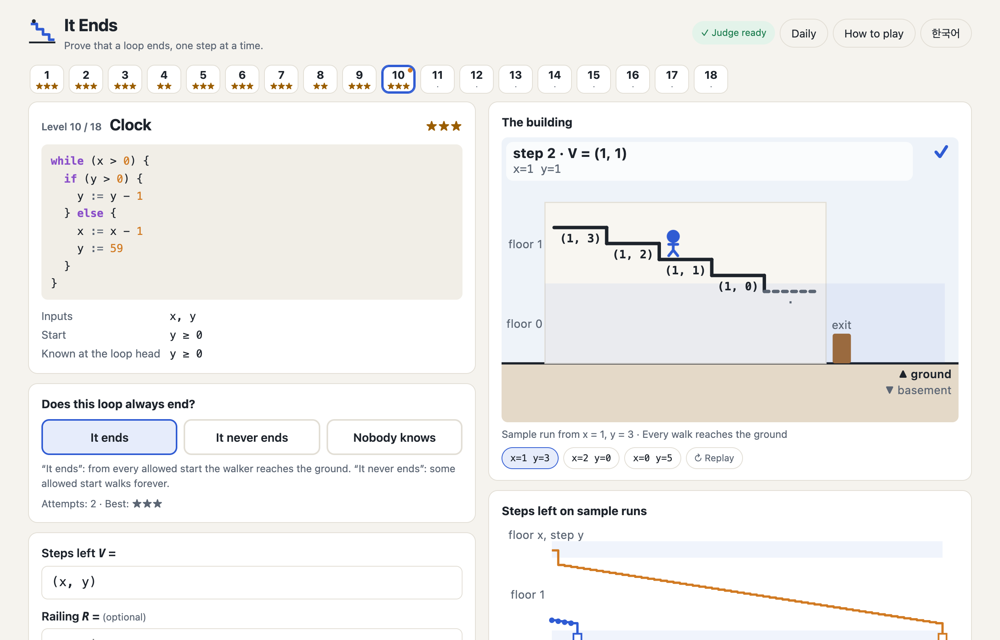

# It Ends

반복문이 끝나는지 증명하는 브라우저 퍼즐 게임 · A browser puzzle game about proving that loops end

플레이 / Play: <https://jkkms.github.io/it-ends/>



[한국어](#한국어) · [English](#english)

---

## 한국어

### 무엇인가요

KAIST CS424(프로그램 논증) 수강생을 위한 **종료(termination) 증명** 게임입니다.
반복문 하나를 **건물 계단을 내려가는 사람**으로 봅니다. 반복 한 번이 계단 한 칸입니다.

앞서 나온 학생 게임 Invariant Frog와 Art of Artillery: Danger Close는 루프 불변식으로 *부분 정확성*을 증명하는 게임이고,
두 게임 모두 **종료**와 변수 3개 이상은 다루지 못한다고 밝힙니다. It Ends는 그 두 가지를 다룹니다.
판정은 브라우저 안에서 돌아가는 SMT 풀이기 **Z3**가 합니다.

### 하는 법

레벨마다 반복문이 하나 있습니다. 먼저 **판정**을 고르고, 그다음 **증명**합니다.

| 판정 | 내는 증명 | 검사 |
|---|---|---|
| **끝난다** | 남은 걸음 V(ranking function). 필요하면 난간 R(보조 불변식)도 | Z3 |
| **안 끝난다** | 영원히 도는 시작값. 상태가 되풀이되지 않으면 바닥 없는 구역 Z(재귀 집합)도 | 실행(상태 반복) 또는 Z3 |
| **아무도 모른다** | 없음 | 마지막 레벨(콜라츠)에서만 정답 |

- 틀린 답에는 언제나 Z3 모델에서 뽑은 **구체적인 반례**가 따라옵니다: 상태, 다음 상태, 그때의 V
  (“이 걸음은 오히려 올라가요. 남은 걸음 1 → 59”, “아직 걷는 중인데 땅 밑 2칸”).
- 남은 걸음 V를 입력하는 동안 건물 그림과 예시 실행 그래프가 바로 바뀝니다.
- 레벨 1~3은 실제 화면 위에서 진행하는 튜토리얼이 있습니다(건너뛰기 가능, “하는 법”에서 다시 보기).
  레벨 5(안 끝나는 반복), 9(난간), 10(튜플) 앞에는 짧은 설명이 나옵니다.
- 별: ★ 해결 · ★★ 3번 안에 · ★★★ 거기에 답 길이 ≤ 기준(끝나는 레벨, 난간 포함, 빈칸 제외) 또는 첫 시도(안 끝나는 레벨과 마지막 레벨).
  식 오류, 허용되지 않는 시작값, 판정기 시간 초과(5초)는 시도로 세지 않습니다.
- 오늘의 문제: UTC 날짜로 하루 한 레벨. 풀고 나면 답은 빼고 시도 기록만 담긴 한 줄을 복사할 수 있습니다
  (예: `It Ends #2026-11-03 L10 ⬇⬇✅ 5 chars`; ⬇ 땅 밑으로 떨어짐, ➡ 평평한 걸음, ⬆ 올라간 걸음, ❌ 그 밖의 실패).
- 한국어/영어 전환(처음에는 브라우저 언어를 따름), 휴대폰 화면(760px 이하 한 단), Enter로 제출.

### 개념 ↔ 게임

| 개념 | 게임 |
|---|---|
| ranking function | 남은 걸음 V |
| 반복하는 동안 V ≥ 0 | 땅 위에 있기 (땅 밑 = 지하로 떨어짐) |
| 매 반복 V가 1 이상 감소 | 매 걸음 내려가기 (평평하거나 올라가는 걸음 = 실패) |
| 사전식 튜플 (a, b) | a층의 b번째 계단. 한 층 내려가면 계단 수가 다시 꼭대기로 |
| 보조 불변식 (supporting invariant) | 난간 R |
| 재귀 집합 (recurrent set) | 바닥 없는 구역 Z |

### 검사 (정확히 이것만)

`Start` = 시작 조건과 초기화, `Facts` = 레벨이 알려 주는 반복 시작 사실, `G` = 반복 조건,
`Step(s, s')` = 몸통의 각 경로에 대해 `경로 조건 ∧ s' = 대입(s)`의 논리합. 모든 변수는 수학의 정수입니다.

- **끝난다**: (R이 있으면) `Start ⇒ R`, `Facts ∧ R ∧ G ∧ Step ⇒ R'` /
  `Facts ∧ R ∧ G ⇒ V ≥ 0` (튜플은 모든 성분) / `Facts ∧ R ∧ G ∧ Step ⇒ V' ≤ V − 1` (튜플은 사전식으로 엄격히 감소)
- **안 끝난다**: 시작값이 `Start`를 만족하는지 보고 10,000걸음까지 실행합니다. 끝나면 증명이 아니고, 상태가 되풀이되면 순환으로 증명입니다.
  둘 다 아니면 Z를 받아 `Z(s0)`, `Z ⇒ G`, `Facts ∧ Z ∧ G ∧ Step ⇒ Z'`를 Z3로 검사합니다.
- 질의마다 Z3 시간 제한 5초. 넘으면 “판정기가 결정하지 못했어요”이고 시도로 세지 않습니다.

`/`와 `%`는 판정기와 실행기 모두 SMT-LIB/Z3 의미(유클리드 나눗셈, 나머지 ≥ 0)를 씁니다. 그래서 실행과 증명이 어긋나지 않습니다
(예: `-7 / 2 = -4`, `-7 % 2 = 1`). SMT-LIB가 정하지 않은 0으로 나누기는 양쪽 모두 `x / 0 = 0`, `x % 0 = x`로 고정했습니다.

### 실행

```sh
npm i
npm run dev          # http://localhost:5173 (개발 서버가 COOP/COEP 헤더를 보냄)
npm test             # node --test: 파서, 18개 레벨 전부, / % 의미 비교 (Node 24 권장)
npm run build        # dist/ (base './', 하위 경로에서도 동작)
npm run serve:pages  # dist/를 http://localhost:4174/it-ends/ 에서 특별한 헤더 없이 제공 (GitHub Pages 흉내)
```

`main`에 푸시하면 `.github/workflows/pages.yml`이 테스트, 빌드 후 `dist/`를 GitHub Pages에 배포합니다.

### 기술 메모

- Vite + TypeScript, UI 프레임워크 없이 DOM/SVG. 런타임 의존성은 `z3-solver` **5.3.1**과 `coi-serviceworker` **0.1.7** 두 개뿐입니다(둘 다 버전 고정).
- Z3는 SharedArrayBuffer가 필요해서 교차 출처 격리(cross-origin isolation)가 필요합니다. 개발 서버는 헤더를 직접 보내고,
  GitHub Pages에서는 `coi-serviceworker`가 붙여 줍니다(처음 방문할 때 한 번 새로고침됨).
- Z3의 Emscripten 로더와 wasm은 번들하지 않고 `public/z3/`에 복사해 정적 파일로 냅니다(`scripts/copy-assets.mjs`).
  wasm(35 MB)은 gzip(약 8 MB)으로 받아 브라우저에서 풉니다. 불러오는 동안에도 화면은 그대로 쓸 수 있습니다.
- 진행 상황(최고 별, 튜토리얼, 오늘의 문제)은 `localStorage`에 저장하며, 저장소를 쓸 수 없어도 게임은 돌아갑니다.
- 코드 구조: `src/core/`(식 언어, 레벨, 실행기, Z3 검사, 게임 규칙), `src/ui/`(화면), `src/z3/`(브라우저용 Z3 로더), `test/`.

### 크레디트

- [Z3](https://github.com/Z3Prover/z3) (Microsoft Research, MIT)와 npm 패키지 `z3-solver`
- [coi-serviceworker](https://github.com/gzuidhof/coi-serviceworker) (Guido Zuidhof, MIT)
- 보드와 비유에 관한 고민의 출발점이 된 두 게임: [Invariant Frog](https://github.com/suhdonghwi/jammy) (suhdonghwi),
  [Art of Artillery: Danger Close](https://github.com/shha-03/art-of-artillery-danger-close) (shha-03). 코드는 가져오지 않았습니다.
- KAIST CS424 프로그램 논증
- 작성자의 설계에 따라 Claude의 도움을 받아 만들었습니다.

### 라이선스

MIT. [LICENSE](LICENSE)를 보세요.

---

## English

### What it is

A **termination-proof** game for students of KAIST CS424 (Program Reasoning).
A loop is **a person walking down the stairs of a building**: one loop iteration is one step.

The earlier student games Invariant Frog and Art of Artillery: Danger Close prove *partial correctness* with loop invariants,
and both say they cannot handle **termination** or more than two or three variables. It Ends handles both.
The judge is the **Z3** SMT solver, running in your browser.

### How to play

Each level is one loop. First give a **verdict**, then **prove** it.

| Verdict | Proof you give | Checked by |
|---|---|---|
| **It ends** | steps left V (a ranking function), optionally a railing R (supporting invariant) | Z3 |
| **It never ends** | a start that runs forever; if the run never repeats a state, also a bottomless zone Z (recurrent set) | simulation (repeated state) or Z3 |
| **Nobody knows** | nothing | right only on the last level (Collatz) |

- A wrong answer always comes with a **concrete counterexample** from Z3's model: the state, the next state and V before and after
  (“this step goes up from 1 to 59 steps left”, “still walking but 2 steps below ground”).
- While you type V, the building and the step chart of the sample runs update immediately.
- Levels 1–3 have an interactive tutorial on the real board (skippable, replay it from “How to play”).
  Short intros come before level 5 (loops that never end), 9 (railings) and 10 (tuples).
- Stars: ★ solved · ★★ within 3 attempts · ★★★ also answer length ≤ par (ends-levels; railing counts, spaces don't) or first attempt (never-levels and the last level).
  Parse errors, disallowed starts and judge timeouts (5 s) cost no attempt.
- Daily puzzle: one level per UTC date. After solving it, copy a line with your attempts but not your answer
  (e.g. `It Ends #2026-11-03 L10 ⬇⬇✅ 5 chars`; ⬇ fell below ground, ➡ flat step, ⬆ step up, ❌ other failure).
- Korean/English toggle (default from the browser language), phone layout (single column below 760 px), Enter submits.

### Concept ↔ game

| Concept | Game |
|---|---|
| ranking function | steps left V |
| V ≥ 0 while looping | staying above ground (below ground = falling into the basement) |
| V decreases by ≥ 1 per iteration | every step goes down (a flat or upward step fails) |
| lexicographic tuple (a, b) | floor a, step b on that floor; going down a floor lets the step count reset to the top |
| supporting invariant | railing R |
| recurrent set | bottomless zone Z |

### The checks (exactly these)

`Start` = start condition plus initialization, `Facts` = loop-head facts the level states, `G` = loop guard,
`Step(s, s')` = disjunction over the body's paths of `path condition ∧ s' = assign(s)`. All variables are mathematical integers.

- **It ends**: (if R is given) `Start ⇒ R` and `Facts ∧ R ∧ G ∧ Step ⇒ R'`;
  `Facts ∧ R ∧ G ⇒ V ≥ 0` (tuples: every component); `Facts ∧ R ∧ G ∧ Step ⇒ V' ≤ V − 1` (tuples: strict lexicographic decrease).
- **It never ends**: the start must satisfy `Start`; it is run for up to 10,000 steps. If the loop exits, it is not a proof; if a state repeats, it is a proof by cycle.
  Otherwise you give Z and Z3 checks `Z(s0)`, `Z ⇒ G`, `Facts ∧ Z ∧ G ∧ Step ⇒ Z'`.
- Z3 timeout per query: 5 s, reported as “the judge could not decide” at no cost.

`/` and `%` use SMT-LIB/Z3 semantics (Euclidean division, remainder ≥ 0) in both the judge and the simulator, so runs and proofs agree
(`-7 / 2 = -4`, `-7 % 2 = 1`). Division by zero, which SMT-LIB leaves open, is fixed to `x / 0 = 0` and `x % 0 = x` on both sides.

### Run it

```sh
npm i
npm run dev          # http://localhost:5173 (the dev server sends COOP/COEP headers)
npm test             # node --test: parser, all 18 levels, / and % against Z3 (Node 24 recommended)
npm run build        # dist/ (base './', works from a sub-path)
npm run serve:pages  # serves dist/ at http://localhost:4174/it-ends/ with no special headers, like GitHub Pages
```

Pushing to `main` runs `.github/workflows/pages.yml`: test, build, deploy `dist/` to GitHub Pages.

### Tech notes

- Vite + TypeScript, plain DOM/SVG. The only runtime dependencies are `z3-solver` **5.3.1** and `coi-serviceworker` **0.1.7** (both pinned).
- Z3 needs SharedArrayBuffer, hence a cross-origin isolated page. The dev server sends the headers; on GitHub Pages
  `coi-serviceworker` adds them (the first visit reloads once).
- Z3's Emscripten loader and wasm are not bundled: `scripts/copy-assets.mjs` copies them to `public/z3/`.
  The 35 MB wasm is fetched gzipped (about 8 MB) and unpacked in the browser. The page stays usable while it loads.
- Progress (best stars, tutorial, daily puzzle) lives in `localStorage`; the game also works without it.
- Layout: `src/core/` (expression language, levels, simulator, Z3 checks, game rules), `src/ui/` (screen), `src/z3/` (browser Z3 loader), `test/`.

### Credits

- [Z3](https://github.com/Z3Prover/z3) (Microsoft Research, MIT) and the `z3-solver` npm package
- [coi-serviceworker](https://github.com/gzuidhof/coi-serviceworker) (Guido Zuidhof, MIT)
- The two earlier games whose boards and metaphors started this discussion: [Invariant Frog](https://github.com/suhdonghwi/jammy) (suhdonghwi)
  and [Art of Artillery: Danger Close](https://github.com/shha-03/art-of-artillery-danger-close) (shha-03). No code was copied.
- KAIST CS424 Program Reasoning
- Built with Claude's help under the author's design.

### License

MIT. See [LICENSE](LICENSE).
