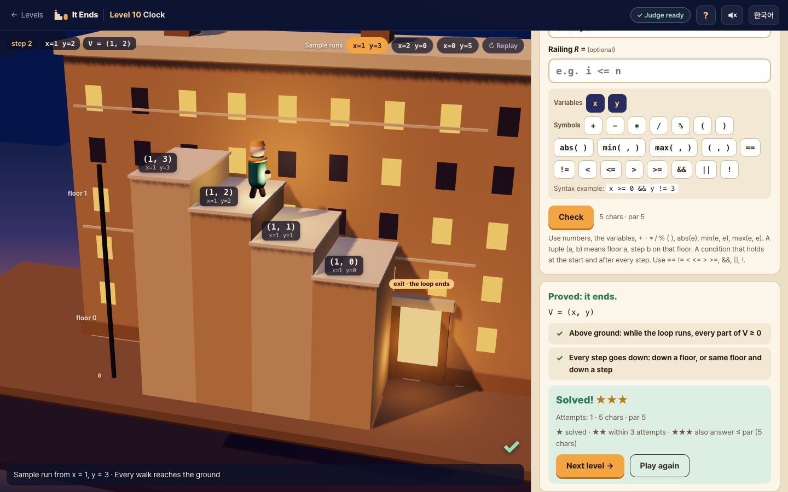

# It Ends

반복문이 끝나는지 증명하는 브라우저 퍼즐 게임 · A browser puzzle game about proving that loops end

플레이 / Play: <https://jkkms.github.io/it-ends/>


[한국어](#한국어) · [English](#english)

---

## 한국어

### 무엇인가요

프로그램이 맞다는 증명은 두 조각입니다. '끝나면 결과가 맞다'(부분 정확성, 루프 불변식)와 '반드시 끝난다'(종료).
It Ends는 뒤 조각을 연습하는 게임입니다. 반복문이 끝나는지 판정하고, 끝난다면 ranking function(남은 계단 수)으로,
안 끝난다면 영원히 도는 시작값으로 증명합니다. 증명은 Z3가 검사합니다. 끝나는지 아무도 모르는 반복문도 하나 있습니다.

KAIST CS424(프로그램 논증) 수강생을 위한 게임입니다. 앞서 나온 학생 게임 Invariant Frog와 Art of Artillery: Danger Close는
루프 불변식으로 *부분 정확성*을 증명하고, 두 게임 모두 **종료**와 변수 3개 이상은 다루지 못한다고 밝힙니다. It Ends는 그 두 가지를 다룹니다.
판정은 브라우저 안에서 돌아가는 SMT 풀이기 **Z3**가 합니다.

### 짧은 하는 법

- **무대**: 건물 앞 계단을 사람이 내려갑니다. 걷는 사람은 실행 중인 프로그램이고, 계단 한 칸은 반복 한 번입니다.
  땅의 높이가 0이고 그 아래는 지하입니다. 걸음마다 **먼저 반복 조건을 확인**합니다. 참이면 본문을 실행하고 한 칸 내려가고,
  거짓이면 문으로 나갑니다(반복 끝). 그래서 처음부터 조건이 거짓이면 0걸음 만에 끝납니다(레벨 2에서 n = −3).
- **계단 높이는 내가 정한다**: "끝난다"를 고르면 식 V를 하나 씁니다. 게임은 예시 실행의 상태 하나하나를 높이 V인 계단으로 그립니다.
  맞는 V는 걷는 동안 땅 밑으로 가지 않고 한 걸음마다 1 이상 내려가는 계단을 그립니다. Z3는 예시만이 아니라 조건이 참인 모든 상태를 검사합니다.
- **입력**: 레벨의 변수, 정수, `+ - * / %`, 괄호, `abs(e)`, `min(e, e)`, `max(e, e)`. 입력칸 아래 칩을 누르면 글자가 들어갑니다.
  `/`와 `%`는 나머지가 0 이상이 되도록 계산합니다(`-7 / 2 = -4`, `-7 % 2 = 1`). 레벨 9부터 난간 R(조건), 레벨 10부터 튜플 `(a, b)`.
- **튜토리얼**은 게임 화면과 따로 있는 모드입니다. 7장(무대 · 계단 높이 · 입력 · 판정 셋 · 난간 · 층과 계단 · 별과 오늘의 문제)을
  무대 위에서 해설과 함께 보여 줍니다. 1–3장은 레벨 1 전에 보면 좋고, 나머지는 해당 레벨에서 "새로 열림"으로 표시됩니다.
  레벨 화면의 `?`는 그 레벨에 필요한 장을 엽니다.


레벨마다 먼저 **판정**을 고르고, 그다음 **증명**합니다.

| 판정 | 내는 증명 | 검사 |
|---|---|---|
| **끝난다** | 남은 계단 V(ranking function). 필요하면 난간 R(보조 불변식)도 | Z3 |
| **안 끝난다** | 영원히 도는 시작값. 상태가 되풀이되지 않으면 바닥 없는 구역 Z(재귀 집합)도 | 실행(상태 반복) 또는 Z3 |
| **아무도 모른다** | 없음 | 마지막 레벨(콜라츠)에서만 정답 |

- 틀린 답에는 언제나 Z3 모델에서 뽑은 **구체적인 반례**가 따라오고, 무대에서 그대로 재생됩니다.
  평평한 걸음이면 휘청하고, 올라가는 걸음이면 빨간 화살표, 땅 밑이면 바닥을 뚫고 지하로 떨어집니다.
  끝나지 않는 실행은 지하로 끝없이 내려가거나(바닥 없는 구역) 둥근 탑 위를 계속 돕니다(순환).
- 재생하는 동안 코드에서 지금 실행되는 줄이 켜집니다(조건 확인은 while 줄, 걸음은 본문 줄).
- 레벨 목록은 장별로 묶여 있고, 모든 레벨이 열려 있습니다. "추천"이 다음 레벨을 알려 줍니다. 카드에는 판정이 나오지 않습니다.
- 별: ★ 해결 · ★★ 3번 안에 · ★★★ 거기에 답 길이 ≤ 기준(끝나는 레벨, 난간 포함, 빈칸 제외) 또는 첫 시도(안 끝나는 레벨과 마지막 레벨).
  식 오류, 허용되지 않는 시작값, 판정기 시간 초과(5초)는 시도로 세지 않습니다.
- 오늘의 문제: UTC 날짜로 하루 한 레벨. 풀고 나면 답은 빼고 시도 기록만 담긴 한 줄을 복사할 수 있습니다
  (예: `It Ends #2026-11-03 L10 ⬇⬇✅ 5 chars`; ⬇ 땅 밑으로 떨어짐, ➡ 평평한 걸음, ⬆ 올라간 걸음, ❌ 그 밖의 실패).
- 한국어/영어 전환(처음에는 브라우저 언어를 따름), 소리 켜기/끄기(기억함), 휴대폰 화면, Enter로 제출.

| 레벨 1: V = 0의 반례 | 레벨 10: 튜플 (x, y) |
|---|---|
|  |  |

### 개념 ↔ 게임

| 개념 | 게임 |
|---|---|
| ranking function | 남은 계단 V (상태마다 그 높이의 계단) |
| 반복하는 동안 V ≥ 0 | 땅 위에 있기 (땅 밑 = 지하로 떨어짐) |
| 매 반복 V가 1 이상 감소 | 매 걸음 내려가기 (평평하거나 올라가는 걸음 = 실패) |
| 사전식 튜플 (a, b) | a층의 b번째 계단. 한 층 내려가면 계단 수가 다시 꼭대기로 |
| 반복 조건이 처음부터 거짓 | 걷기 전에 문으로 나감 (0걸음) |
| 보조 불변식 (supporting invariant) | 난간 R |
| 재귀 집합 (recurrent set) | 바닥 없는 구역 Z |

### 검사 (정확히 이것만)

`Start` = 시작 조건과 초기화, `Facts` = 레벨이 알려 주는 반복 시작 사실, `G` = 반복 조건,
`Step(s, s')` = 몸통의 각 경로에 대해 `경로 조건 ∧ s' = 대입(s)`의 논리합. 모든 변수는 수학의 정수입니다.

- **끝난다**: (R이 있으면) `Start ⇒ R`, `Facts ∧ R ∧ G ∧ Step ⇒ R'` /
  `Facts ∧ R ∧ G ⇒ V ≥ 0` (튜플은 모든 성분) / `Facts ∧ R ∧ G ∧ Step ⇒ V' ≤ V − 1` (튜플은 사전식으로 엄격히 감소)
- **안 끝난다**: 시작값이 `Start`를 만족하는지 보고 10,000걸음까지 실행합니다. 끝나면 증명이 아니고, 상태가 되풀이되면 순환으로 증명입니다.
  둘 다 아니면 Z를 받아 `Z(s0)`, `Z ⇒ G`, `Facts ∧ Z ∧ G ∧ Step ⇒ Z'`를 Z3로 검사합니다.
- 질의마다 Z3 시간 제한 5초. 넘으면 “판정기가 결정하지 못했어요”이고 시도로 세지 않습니다.

`/`와 `%`는 판정기와 실행기 모두 SMT-LIB/Z3 의미(유클리드 나눗셈, 나머지 ≥ 0)를 씁니다. 그래서 실행과 증명이 어긋나지 않습니다
(예: `-7 / 2 = -4`, `-7 % 2 = 1`). SMT-LIB가 정하지 않은 0으로 나누기는 양쪽 모두 `x / 0 = 0`, `x % 0 = x`로 고정했습니다.

### 실행

```sh
npm i
npm run dev          # http://localhost:5173 (개발 서버가 COOP/COEP 헤더를 보냄)
npm test             # node --test: 파서, 18개 레벨 전부, / % 의미 비교, 무대·튜토리얼 데이터 (Node 24 권장)
npm run build        # dist/ (base './', 하위 경로에서도 동작)
npm run serve:pages  # dist/를 http://localhost:4174/it-ends/ 에서 특별한 헤더 없이 제공 (GitHub Pages 흉내)
```

주소 끝에 `?mute`를 붙이면 소리가 나지 않고, `?flat`을 붙이면 3D 대신 평면 그림으로 봅니다(WebGL이 없을 때 자동으로 쓰는 그림).

`main`에 푸시하면 `.github/workflows/pages.yml`이 테스트, 빌드 후 `dist/`를 GitHub Pages에 배포합니다.

### 기술 메모

- Vite + TypeScript, UI 프레임워크 없이 DOM. 무대는 [three.js](https://threejs.org) **0.186.1**로 그리며, 무대가 처음 필요할 때
  별도 청크로 불러옵니다(WebGL을 쓸 수 없으면 v0.1의 평면 SVG 그림으로 대신합니다).
  런타임 의존성은 `three`, `z3-solver` **5.3.1**, `coi-serviceworker` **0.1.7** 셋이며 모두 버전을 고정했습니다.
- 글꼴은 [Pretendard](https://github.com/orioncactus/pretendard) **1.3.9**(SIL OFL 1.1)를 직접 냅니다. 공식 가변 글꼴의
  unicode-range 분할본을 수정 없이 복사하므로, 화면에 나온 글자에 필요한 조각만 내려받습니다. 라이선스는
  [licenses/Pretendard-OFL-1.1.txt](licenses/Pretendard-OFL-1.1.txt)와 배포본의 `fonts/LICENSE.txt`에 있습니다.
- 소리는 파일 없이 WebAudio로 만듭니다(걸음, 착지, 실패, 해결). `prefers-reduced-motion`이면 애니메이션이 짧아집니다.
- Z3는 SharedArrayBuffer가 필요해서 교차 출처 격리(cross-origin isolation)가 필요합니다. 개발 서버는 헤더를 직접 보내고,
  GitHub Pages에서는 `coi-serviceworker`가 붙여 줍니다(처음 방문할 때 한 번 새로고침됨).
- Z3의 Emscripten 로더와 wasm, 글꼴은 번들하지 않고 `scripts/copy-assets.mjs`가 `public/`에 복사합니다.
  wasm(35 MB)은 gzip(약 8 MB)으로 받아 브라우저에서 풉니다. 불러오는 동안에도 화면은 그대로 쓸 수 있습니다.
- 진행 상황(최고 별, 읽은 튜토리얼 장, 오늘의 문제, 소리 설정)은 `localStorage`에 저장하며, 저장소를 쓸 수 없어도 게임은 돌아갑니다.
- 코드 구조: `src/core/`(식 언어, 레벨, 실행기, Z3 검사, 게임 규칙, 무대에 그릴 계단 데이터, 레벨 묶음, 튜토리얼 장),
  `src/ui/`(화면: 처음 화면, 튜토리얼, 레벨 목록, 레벨, 3D 무대), `src/z3/`(브라우저용 Z3 로더), `test/`.

### 크레디트

- [Z3](https://github.com/Z3Prover/z3) (Microsoft Research, MIT)와 npm 패키지 `z3-solver`
- [coi-serviceworker](https://github.com/gzuidhof/coi-serviceworker) (Guido Zuidhof, MIT)
- [three.js](https://github.com/mrdoob/three.js) (MIT), [Pretendard](https://github.com/orioncactus/pretendard) (길형진, SIL OFL 1.1)
- 보드와 비유에 관한 고민의 출발점이 된 두 게임: [Invariant Frog](https://github.com/suhdonghwi/jammy) (suhdonghwi),
  [Art of Artillery: Danger Close](https://github.com/shha-03/art-of-artillery-danger-close) (shha-03). 코드는 가져오지 않았습니다.
- KAIST CS424 프로그램 논증
- 작성자의 설계에 따라 Claude의 도움을 받아 만들었습니다.

### 라이선스

MIT. [LICENSE](LICENSE)를 보세요.

---

## English

### What it is

A proof that a program is correct has two pieces: 'if it ends, the result is right' (partial correctness, loop invariants)
and 'it does end' (termination). It Ends is a game for practising the second piece. Decide whether a loop ends; if it does,
prove it with a ranking function (the number of stairs left); if it does not, prove it with a start that runs forever.
Z3 checks every proof. And one loop is in here that nobody knows the answer to.

It is made for students of KAIST CS424 (Program Reasoning). The earlier student games Invariant Frog and Art of Artillery:
Danger Close prove *partial correctness* with loop invariants, and both say they cannot handle **termination** or more than two
or three variables. It Ends handles both. The judge is the **Z3** SMT solver, running in your browser.

### How to play, in short

- **The stage**: a person walks down the stairs in front of a building. The walker is the running program; one stair is one
  loop iteration. The ground is height 0 and below it is the basement. Before every step the walker **checks the loop condition
  first**: true, run the body and go down a stair; false, leave through the door (the loop has ended). So a start where the
  condition is already false ends after 0 steps (level 2 with n = −3).
- **You set the stair heights**: pick "It ends" and write one expression V. The game draws every state of the sample runs as a
  stair at height V. A correct V draws stairs that never go below ground while walking and go down by at least 1 at every step.
  Z3 checks every state where the condition holds, not only the samples.
- **What you can type**: the level's variables, whole numbers, `+ - * / %`, parentheses, `abs(e)`, `min(e, e)`, `max(e, e)`;
  chips under the answer box type them for you. `/` and `%` keep the remainder ≥ 0 (`-7 / 2 = -4`, `-7 % 2 = 1`).
  A railing R (a condition) from level 9, a tuple `(a, b)` from level 10.
- **The tutorial** is its own mode, separate from the game screen: seven narrated chapters on the stage (the stage · you set the
  stair heights · what you can type · three verdicts · railings · floors and steps · stars and the daily puzzle).
  Chapters 1–3 are suggested before level 1; the others are marked "new" when a level needs them. The `?` on a level opens
  the chapter that level needs.


Each level: first a **verdict**, then a **proof**.

| Verdict | Proof you give | Checked by |
|---|---|---|
| **It ends** | stairs left V (a ranking function), optionally a railing R (supporting invariant) | Z3 |
| **It never ends** | a start that runs forever; if the run never repeats a state, also a bottomless zone Z (recurrent set) | simulation (repeated state) or Z3 |
| **Nobody knows** | nothing | right only on the last level (Collatz) |

- A wrong answer always comes with a **concrete counterexample** from Z3's model, played on the stage: a flat step makes the
  walker stumble, a step up gets a red arrow, below ground the walker falls through the floor. A run that never ends keeps
  going down into the basement (a bottomless zone) or circles a round tower (a cycle).
- While the walk plays, the code lights up the line that runs (the while line for each check, the body for each step).
- The level select groups levels by chapter; every level is open, and "Next up" points at the next one. Cards never show a verdict.
- Stars: ★ solved · ★★ within 3 attempts · ★★★ also answer length ≤ par (ends-levels; railing counts, spaces don't) or first attempt (never-levels and the last level).
  Parse errors, disallowed starts and judge timeouts (5 s) cost no attempt.
- Daily puzzle: one level per UTC date. After solving it, copy a line with your attempts but not your answer
  (e.g. `It Ends #2026-11-03 L10 ⬇⬇✅ 5 chars`; ⬇ fell below ground, ➡ flat step, ⬆ step up, ❌ other failure).
- Korean/English toggle (default from the browser language), sound on/off (remembered), phone layout, Enter submits.

| Level 1: the counterexample to V = 0 | Level 10: the tuple (x, y) |
|---|---|
|  |  |

### Concept ↔ game

| Concept | Game |
|---|---|
| ranking function | stairs left V (each state is a stair at that height) |
| V ≥ 0 while looping | staying above ground (below ground = falling into the basement) |
| V decreases by ≥ 1 per iteration | every step goes down (a flat or upward step fails) |
| lexicographic tuple (a, b) | floor a, step b on that floor; going down a floor lets the step count reset to the top |
| loop condition false at the start | the walker leaves through the door before any step (0 steps) |
| supporting invariant | railing R |
| recurrent set | bottomless zone Z |

### The checks (exactly these)

`Start` = start condition plus initialization, `Facts` = loop-head facts the level states, `G` = loop guard,
`Step(s, s')` = disjunction over the body's paths of `path condition ∧ s' = assign(s)`. All variables are mathematical integers.

- **It ends**: (if R is given) `Start ⇒ R` and `Facts ∧ R ∧ G ∧ Step ⇒ R'`;
  `Facts ∧ R ∧ G ⇒ V ≥ 0` (tuples: every component); `Facts ∧ R ∧ G ∧ Step ⇒ V' ≤ V − 1` (tuples: strict lexicographic decrease).
- **It never ends**: the start must satisfy `Start`; it is run for up to 10,000 steps. If the loop exits, it is not a proof; if a state repeats, it is a proof by cycle.
  Otherwise you give Z and Z3 checks `Z(s0)`, `Z ⇒ G`, `Facts ∧ Z ∧ G ∧ Step ⇒ Z'`.
- Z3 timeout per query: 5 s, reported as “the judge could not decide” at no cost.

`/` and `%` use SMT-LIB/Z3 semantics (Euclidean division, remainder ≥ 0) in both the judge and the simulator, so runs and proofs agree
(`-7 / 2 = -4`, `-7 % 2 = 1`). Division by zero, which SMT-LIB leaves open, is fixed to `x / 0 = 0` and `x % 0 = x` on both sides.

### Run it

```sh
npm i
npm run dev          # http://localhost:5173 (the dev server sends COOP/COEP headers)
npm test             # node --test: parser, all 18 levels, / and % against Z3, stage and tutorial data (Node 24 recommended)
npm run build        # dist/ (base './', works from a sub-path)
npm run serve:pages  # serves dist/ at http://localhost:4174/it-ends/ with no special headers, like GitHub Pages
```

Add `?mute` to the address for silence, or `?flat` for the flat drawing instead of 3-D (used automatically without WebGL).

Pushing to `main` runs `.github/workflows/pages.yml`: test, build, deploy `dist/` to GitHub Pages.

### Tech notes

- Vite + TypeScript, plain DOM. The stage is drawn with [three.js](https://threejs.org) **0.186.1** in its own lazily loaded chunk
  (without WebGL, the flat SVG drawing of v0.1 stands in). Runtime dependencies: `three`, `z3-solver` **5.3.1** and
  `coi-serviceworker` **0.1.7**, all pinned.
- The font is [Pretendard](https://github.com/orioncactus/pretendard) **1.3.9** (SIL OFL 1.1), self-hosted: the official,
  unmodified variable-weight subsets split by unicode-range, so a browser downloads only the pieces for the characters on screen.
  License: [licenses/Pretendard-OFL-1.1.txt](licenses/Pretendard-OFL-1.1.txt) and `fonts/LICENSE.txt` in the build.
- Sounds are generated with WebAudio (step, landing, failure, solved); no sound files. `prefers-reduced-motion` shortens the animations.
- Z3 needs SharedArrayBuffer, hence a cross-origin isolated page. The dev server sends the headers; on GitHub Pages
  `coi-serviceworker` adds them (the first visit reloads once).
- Z3's Emscripten loader and wasm and the font files are not bundled: `scripts/copy-assets.mjs` copies them to `public/`.
  The 35 MB wasm is fetched gzipped (about 8 MB) and unpacked in the browser. The page stays usable while it loads.
- Progress (best stars, tutorial chapters read, daily puzzle, sound setting) lives in `localStorage`; the game also works without it.
- Layout: `src/core/` (expression language, levels, simulator, Z3 checks, game rules, the stairs the stage draws, level groups,
  tutorial chapters), `src/ui/` (screens: title, tutorial, level select, level, 3-D stage), `src/z3/` (browser Z3 loader), `test/`.

### Credits

- [Z3](https://github.com/Z3Prover/z3) (Microsoft Research, MIT) and the `z3-solver` npm package
- [coi-serviceworker](https://github.com/gzuidhof/coi-serviceworker) (Guido Zuidhof, MIT)
- [three.js](https://github.com/mrdoob/three.js) (MIT), [Pretendard](https://github.com/orioncactus/pretendard) (Kil Hyung-jin, SIL OFL 1.1)
- The two earlier games whose boards and metaphors started this discussion: [Invariant Frog](https://github.com/suhdonghwi/jammy) (suhdonghwi)
  and [Art of Artillery: Danger Close](https://github.com/shha-03/art-of-artillery-danger-close) (shha-03). No code was copied.
- KAIST CS424 Program Reasoning
- Built with Claude's help under the author's design.

### License

MIT. See [LICENSE](LICENSE).
